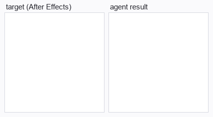
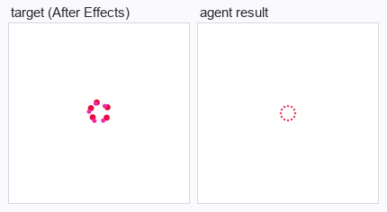
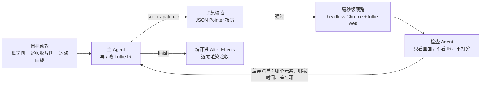
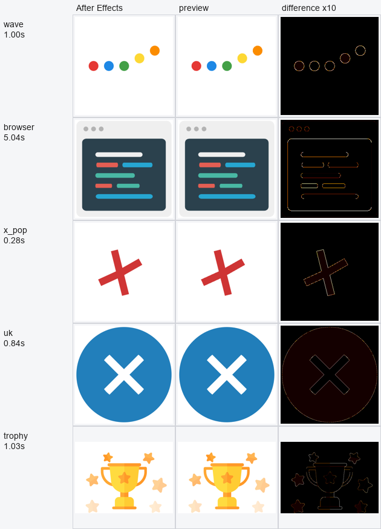
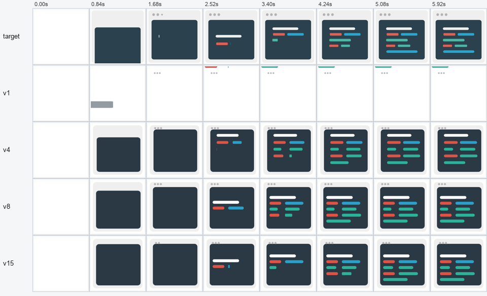

# motion-replica

让大模型看着一段 After Effects 动效，把它复刻成能编译回 AE 的 Lottie 动画。

一个 Agent 负责写动画；另一个独立的检查 Agent（同一个模型、全新会话）只看画面，告诉它哪里不像、差在什么时间。整个闭环里没有任何分数。

| 浏览器窗口（6 s，149 帧） | 支付卡片（3.3 s，100 帧） | 叉号弹出（2 s，120 帧） |
|---|---|---|
|  |  |  |

左边是目标，右边是 Agent 的结果。浏览器窗口和叉号的目标是 AE 渲染；支付卡片是自制任务，目标由预览渲染。模型：DeepSeek V4.1 Flash，经 Devin 客户端调用，禁用全部工具。

## 怎么工作



主 Agent 每一步回复一个 JSON 动作：

| 动作 | 作用 |
|---|---|
| `set_ir` / `patch_ir` | 整体写入 / 用 JSON Patch 局部修改动画 |
| `preview` | 指定时间点的 目标 / 当前 / 差异热图 |
| `review` | 请检查 Agent 做一次完整检查 |
| `get_ir` / `finish` | 读回当前动画 / 交付 |

## 关键设计

**1. 一个能精确回到 AE 的动画格式。** Agent 写的是 Lottie 的一个子集：形状图层、路径、填充描边、嵌套组、图层变换关键帧和三次缓动。子集里的每一项都在 AE 里逐项验证过，构建器把 Lottie 缓动精确换算成 AE 的 speed/influence。超出子集的写法会被直接拒绝，报错带 JSON Pointer（如 `/layers/3/ks/p`），Agent 可以直接 patch。

**2. 毫秒级预览，和 AE 渲染一致。** 预览用常驻的 headless Chrome + lottie-web，渲染一帧约 10 ms。Agent 迭代时完全不开 AE，交付后才编译一次。前提是预览和 AE 画出来的东西一样，见下一节。

**3. 用看图的检查 Agent 代替分数。** 早期版本把像素指标、形状指标当作闭环反馈，Agent 会去优化指标本身：画面明显不对时分数依然很高。现在的反馈全部来自画面：

- **快检**：每次修改被接受后自动触发，不占动作数。检查 Agent 看 目标 / 上一版 / 这一版 的 16 帧胶片图，回答变好、持平还是变差，并列出最大的 3 处差异。
- **完整检查**：48 帧胶片图加每种颜色元素的运动曲线（面积、x、y 随时间变化），可以放大任意 1 秒逐帧看节奏，最后给出“还有没有明显差异”的结论。从第 12 步起自动触发一次，临近结束再触发一次。
- 检查 Agent 看不到 IR、看不到主 Agent 的对话，也没有分数可看，只能描述它看到的差异。

**4. 把模型限制在规定动作里。** 客户端以 Ask 模式启动，配置里禁用全部内置工具。主 Agent 一旦发起工具调用，这次运行作废。检查 Agent 调工具，或把工具调用写成文本（DeepSeek 的 DSML），就换一个新会话重答，不连累主 Agent。

## 预览与 AE 的还原度

lottie-web 和 AE 对同一份 Lottie 的求值并不完全相同。例如带空间切线的位置动画：切线与运动方向共线时，lottie-web 会把切线丢掉、改成逐维插值，AE 始终沿空间曲线按弧长推进；遇到回弹、过冲这种切线反向的情况，两者就会画得不一样。没修正之前，奖杯最差的一帧平均差 0.77/255，差异超过 40 的像素有 2308 个。现在预览前会找出这类“共线且回折”的段，把出切线沿法向推开 0.01 px，让 lottie-web 保留空间曲线；送进 AE 的动画不变。修正后最差一帧降到 0.17/255、598 个像素。

**参考答案**：5 个任务的参考答案在预览里渲染，和 AE 26 渲染的参考帧逐帧比较，共 438 帧（像素差按 0–255 计）：

| 任务 | 帧数 | 单帧平均差 最大 | 中位 | 差异 >40 的像素 最多 |
|---|---:|---:|---:|---:|
| 加载波浪 | 40 | 0.10 | 0.10 | 0.10% |
| 浏览器窗口 | 149 | 0.34 | 0.28 | 0.06% |
| 叉号弹出 | 120 | 0.15 | 0.11 | 0.11% |
| 圆形旗帜 | 69 | 0.82 | 0.51 | 0.37% |
| 奖杯 | 60 | 0.17 | 0.09 | 0.27% |



每个任务取差异最大的一帧，把差异放大 10 倍。剩下的差异只出现在形状边缘，是单像素抗锯齿轮廓；形状、颜色、层次和时间都一致。

**模型写的动画**：早期实验里有 47 个由模型写出、交付后编译进 AE 的动画，预览帧和 AE 帧都保留着，共 4111 帧。每个动画的平均像素差中位数 0.13/255，最大 0.62/255；最差的单帧 1.3/255，差异超过 40 的像素最多占 0.67%。

这些数是这几个任务上的观测结果，不是任意动画都等价的证明。表格和图由 `docs/build_media.py` 从仓库里的参考答案重新生成，不需要开 AE。

## 一次迭代：浏览器窗口



| 版本 | 发生了什么 |
|---|---|
| v1 | 只画出了圆点和几根贴边的细条。快检：*“yours never draws the card at all … target grows a dark navy rounded rect from ~0.80 s”* |
| v4 | 按快检意见补出面板、标题条和代码条。快检：变好，但 *“skeleton rows appear too early … target adds one row per ~0.4 s”* |
| v8 | 第 12 步自动完整检查，检查 Agent 放大 1.00–2.00 s 逐帧看后指出：*“yours starts ~0.2 s too early and darkens too gradually”*，代码条整体 *“runs ~0.12–0.24 s ahead”* |
| v15 | 之后全部用 `patch_ir` 小步修改：标题条和第一行代码条的出现时间对上目标，后面几行的出现节奏放慢、更接近目标。第 23 步交付 |

完整记录在 [`results/browser`](results/browser)：每一版 IR、每一次检查的图片和原文、主 Agent 的逐步对话。

## 结果与局限

[`results/`](results) 里是上面三个动效和奖杯的完整运行记录，是从同一框架的多次运行里挑出来的。浏览器窗口和支付卡片用的是当前代码；奖杯和叉号是在加入“自动完整检查”之前跑的，其余机制相同。

- **和一次生成的对照**（[`results/comparison`](results/comparison)，每个条件 3 次）：闭环在部分任务上明显改进了元素出现的时机（误差均值 0.16 s → 0.04 s），但形状和位置没有一致的提升。
- **检查 Agent 是有效的**：它能指出入场时间、缓动、元素先后、位置偏移这类只看几帧静止画面看不出来的问题，说法具体到像素和秒。
- **结果不稳定**：同一个任务多次运行，质量差别很大（同一框架下浏览器窗口 3 次运行，一次面板偏出画布）。
- **主 Agent 前期爱整段重写**：第一次完整检查之前，常常反复 `set_ir` 重写，检查之后才转成按意见 `patch_ir`。
- **复杂形状画不好**：奖杯（14 个图层、26 条自由路径）上，检查 Agent 在 15 次快检里反复指出杯身五角星缺失、星星爆发太小，主 Agent 却整段重写了 11 次，每次把做对的部分又改丢，用完 24 步也没补上（[`results/trophy`](results/trophy)）。元素多但形状规整的动效（浏览器窗口、支付卡片）要稳得多。
- **子集有边界**：圆形旗帜（uk）要用路径一块块画出被圆裁切的扇形；子集不提供蒙版，Agent 算不出这种几何，只画出了方形旗帜。
- 一次运行 13–21 分钟（上限 25 分钟），其中检查 Agent 占 6–10 分钟。

## 目录

```
replica/
  loop.py       会话状态与动作执行（loop / oneshot 两种条件）
  checker.py    检查 Agent：快检、完整检查、放大、换会话重试
  pictures.py   胶片图、运动曲线、预览对比图（只做可视化，不打分）
  ir.py         Lottie 子集校验、JSON Patch
  proxy.py      常驻预览渲染
  ae.py         编译进 AE、渲染帧
  models.py     Devin ACP 客户端（Ask 模式，禁用工具）
  prompts.py    提示词
  run.py        跑一次；batch.py 并行跑多次；verify.py 交付物进 AE 验收
  vendor/       AE 构建脚本、子集规范化、预览适配器、AE 单实例派发
tasks/          6 个动效任务（hidden/ 为参考答案，Agent 看不到）
tools/          payment_card.py 生成支付卡片任务；score.py、aspects.py 离线评分与对照
results/        展示用的完整运行记录
tests/          selftest：用脚本化会话端到端检查全部机制
docs/           README 图片与生成脚本
```

## 运行

需要 Python 3（numpy、Pillow）、Node 与 Chrome；调用模型需要 Devin 桌面客户端；AE 验收需要 After Effects 2026。

```bash
npm install
python3 tests/selftest.py                          # 不调用模型、不开 AE，约 1 分钟
python3 -m replica.run --model dsflash --task browser --out runs/browser-1
python3 -m replica.verify runs/browser-1           # 交付物编译进 AE，和预览逐帧对比
python3 docs/build_media.py                        # 重新生成 README 图片
```

## 任务素材

5 个动效来自 [lottie-android](https://github.com/airbnb/lottie-android) 的 `snapshot-tests/.../lottiefiles`（仓库 Apache-2.0，原作者为 LottieFiles 创作者）：加载波浪、浏览器窗口、奖杯、圆形旗帜、叉号弹出。参考帧是参考答案在 AE 26 里的真实渲染。

支付卡片是自制任务（`python3 tools/payment_card.py` 生成）：16 个图层，只用圆角矩形、圆和一条对勾折线，动画全部是图层变换，复杂度来自元素的先后和缓动。它的参考帧由预览渲染，没有经过 AE。
